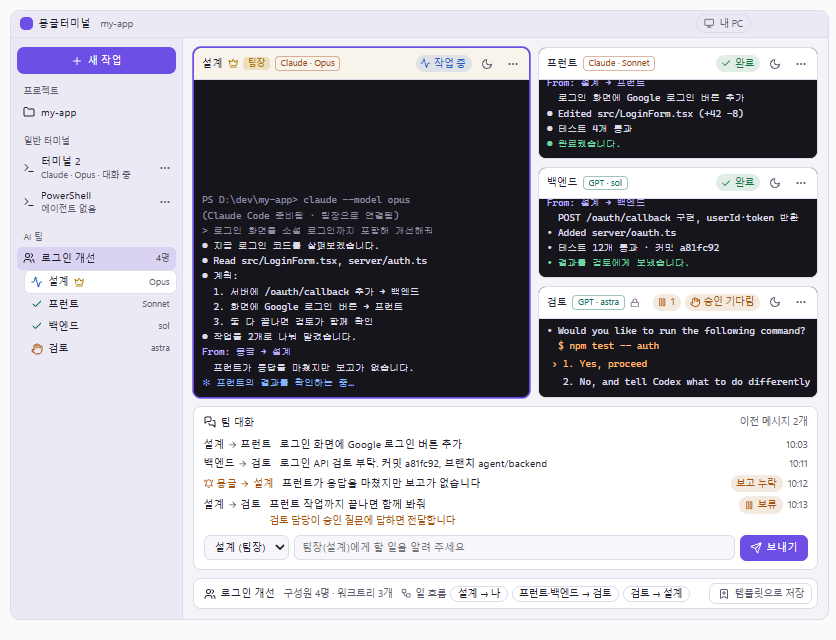
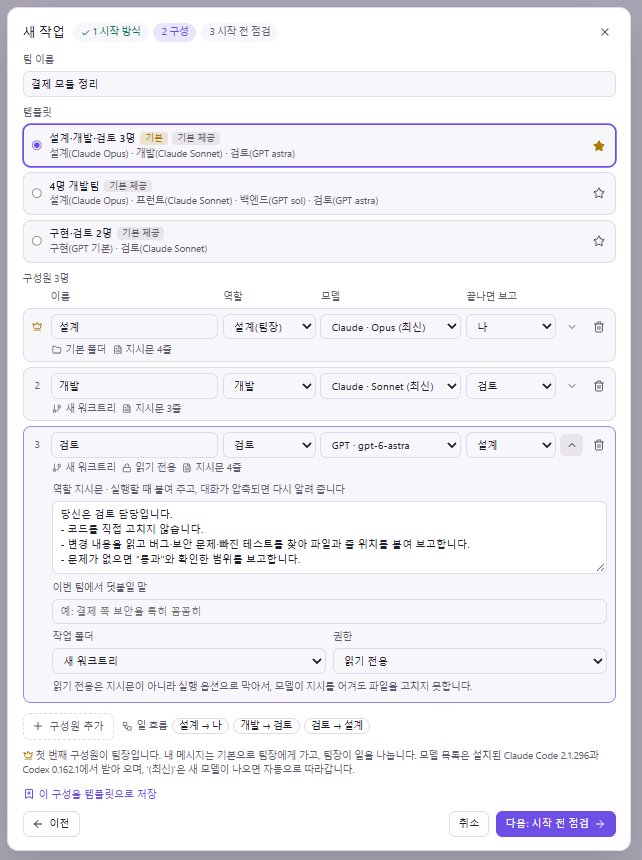
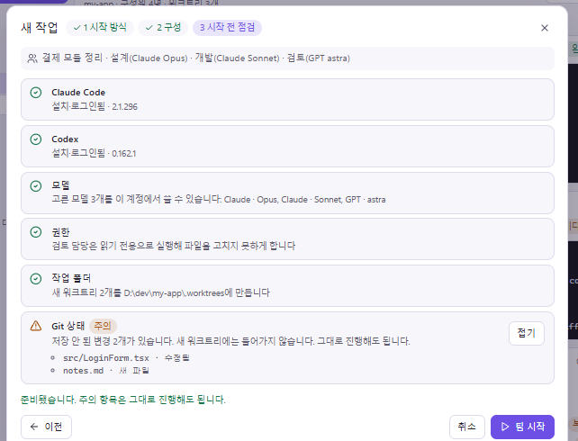
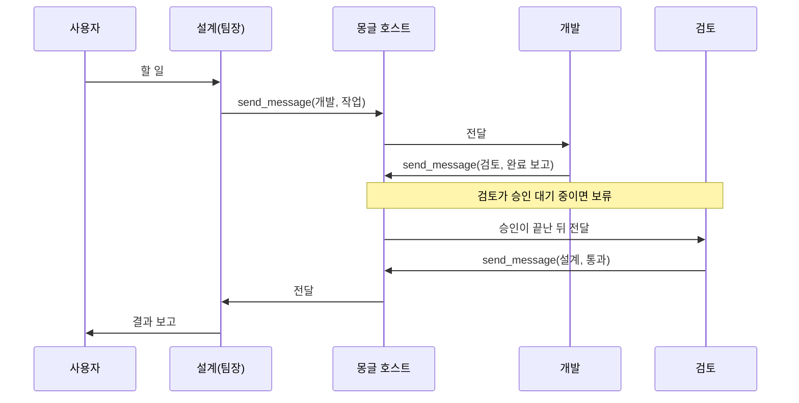

# AI 팀 기능 설계안

작성일: 2026-10-14 · 상태: 구현 전 설계 기준 · 대상: 몽글터미널 0.3.23(`dev` `ded87a3`) 코드 기준

**Claude Code와 Codex 여러 개를 한 팀으로 묶어, 팀장 에이전트가 일을 나누고 구성원끼리 메시지를 주고받게 한다.** 각 구성원은 업체의 CLI를 그대로 실행한다. 몽글은 실행, 작업 폴더 분리, 메시지 전달·보류, 상태 표시만 맡는다.

이 문서는 사용자와 합의한 사용 흐름과 화면, 기술 방향, 단계별 구현 순서, 구현 전에 확인할 항목을 보존한다. 구현이나 검증 결과가 아니며 공개 배포를 뜻하지 않는다. 화면 이미지는 설계 대화 중에 만든 HTML 시안을 찍은 것이다. 실제 앱 화면이 아니며, [Mobbin](https://mobbin.com) 사례를 확인하기 전의 초안이다.

## 방향 변경

초기 설계의 [정한 방향](README.md#정한-방향)은 "CLI는 사용자가 직접 실행하며 별도 AI 채팅/agent 연동은 만들지 않는다"였다. 이 설계는 그 범위를 다음처럼 넓힌다.

- 몽글이 자체 AI 채팅을 만들거나 모델 API를 직접 부르지 않는다는 점은 그대로 둔다.
- 사용자가 고른 구성대로 Claude Code·Codex CLI를 실행하고, 그 사이의 메시지 전달과 상태 관리를 몽글이 맡는다.
- 팀은 선택 기능이다. 팀을 만들지 않으면 지금과 똑같이 동작한다.

## 참고한 프로젝트: OpenRig

[OpenRig](https://github.com/mvschwarz/openrig)(Apache-2.0)는 tmux 위에서 Claude Code·Codex 팀을 운영하는 데몬·CLI·MCP 서버다. 2026-10-11에 `bed4d45`(0.6.9), 2026-10-14에 `c4adbff`(0.6.10)를 내려받아 코드와 문서를 읽었다. README 기준으로 네이티브 Windows는 지원하지 않고 WSL2만 지원한다.

| 가져올 아이디어 | 가져오지 않을 것 |
|---|---|
| 팀·구성원과 터미널 세션을 분리하는 구조 | 화면 글자를 읽어 상태를 추측하는 방식 |
| 승인 대기·사람 입력 중이면 메시지를 보류하는 전달 보호(`SeatDeliveryGuard`) | CLI 메뉴를 대신 눌러 넘기는 처리 |
| 보낸 사람·받는 사람·답장 방법이 붙은 메시지 형식 | 사용자의 CLI 설정 파일에 쓰는 처리 |
| 동료 목록과 보고 관계(`delegates_to`)를 구성원에게 알려 주기 | 특정 CLI 버전의 화면 문구에 맞춘 처리 |
| 팀 설계도(템플릿)로 팀을 띄우는 방식, 실행 전 미리 보기 | 큰 작업 대기열·운영 관리 기능 전체 |
| 긴 대화에서 역할을 다시 알려 주는 장치(refocus) | |

OpenRig는 2026-10-11부터 14일까지 커밋 107개를 반영했다. 그중 여러 개가 업체 화면 변화에 맞춘 수정이었다. Codex 입력창 기호 `»` 인식([#635](https://github.com/mvschwarz/openrig/pull/635)), Codex 전달 확인([#1220](https://github.com/mvschwarz/openrig/pull/1220)), Claude 모드 표시줄 인식([#1179](https://github.com/mvschwarz/openrig/pull/1179)), 잘린 화면을 "알 수 없음"으로 표시([#1226](https://github.com/mvschwarz/openrig/pull/1226))가 그 예다. 몽글은 화면 판독에 기대지 않고 업체가 제공하는 연결을 쓴다.

OpenRig 코드를 그대로 복사하지 않는다. 작은 조각을 가져오게 되면 [제3자 고지](THIRD-PARTY-NOTICES.md)에 기록한다.

## 확정 요구와 제안 기본값

| 구분 | 내용 |
|---|---|
| 사용자 요구 | 팀은 선택 기능이다. 혼자 쓰는 흐름은 바뀌지 않는다. |
| 사용자 요구 | 새 작업을 시작할 때 혼자 할지, 팀으로 할지, 어떤 팀으로 할지 고른다. |
| 사용자 요구 | 일반 터미널에서 하던 작업을 팀으로 바꿀 수 있다. 그 터미널이 팀장이 되고 대화를 이어 간다. |
| 사용자 요구 | 기본 팀 구성(템플릿)을 제공하고, 고쳐서 내 템플릿으로 저장할 수 있다. |
| 사용자 요구 | 일을 나누는 판단은 팀장 에이전트가 한다. 몽글은 일을 나누지 않는다. |
| 사용자 요구 | 각 업체 CLI의 기능을 그대로 쓰고, CLI가 업데이트돼도 크게 흔들리지 않아야 한다. |
| 사용자 요구 | 모델은 Claude 계열과 GPT 계열만 쓴다. 목록은 업체 도구에서 그때그때 받는다. |
| 사용자 요구 | 역할을 고르면 미리 준비된 지시문이 따라오고, 고칠 수 있다. |
| 사용자 요구 | 터미널마다 팀에 넣고 뺄 수 있고, 잠시 메시지를 막는 방해 금지가 있다. |
| 사용자 요구 | 왼쪽 목록은 새 작업 → 프로젝트 → 일반 터미널 → AI 팀 순서다. |
| 사용자 요구 | 팀 화면은 팀장 터미널을 크게 두고 터미널을 맨 위에 둔다. 자주 바꾸지 않는 팀 정보는 맨 아래 한 줄에 둔다. |
| 제안 기본값 | 첫 번째 구성원이 팀장이다. 사용자의 메시지는 기본으로 팀장에게 간다. |
| 제안 기본값 | 팀장은 기본 작업 폴더, 나머지 구성원은 새 워크트리에서 일한다. 2026-10-15 변경: 사용자 의견에 따라 모두 기본 폴더에서 시작하고 새 워크트리는 구성원별로 고른다([작업 범위](validation/agent-team-scope.md)). |
| 제안 기본값 | 검토·조사 역할은 읽기 전용으로 실행한다. 지시문이 아니라 CLI 실행 옵션으로 막는다. |
| 제안 기본값 | 한 팀은 최대 6명이다. |
| 제안 기본값 | 기본 제공 템플릿은 덮어쓰지 않고, 고친 구성은 새 템플릿으로 저장한다. |
| 제안 범위 | 처음에는 이 PC의 PowerShell 터미널만 구성원이 될 수 있다. WSL 셸에는 지금 에이전트 연결 통로가 없다. |

## 사용 흐름

### 새 작업 시작

1. 왼쪽 맨 위 **새 작업**을 누른다.
2. **혼자 하기**(기본) 또는 **팀으로 하기**를 고른다. 혼자 하기는 모델을 고르고 일반 터미널을 연다.
3. 팀으로 하기는 템플릿을 고르고 필요하면 구성원을 고친다. 별표로 정한 기본 템플릿이 미리 골라져 있다.
4. **시작 전 점검**에서 CLI 설치·로그인, 고른 모델, 권한, 작업 폴더, Git 상태를 확인한다. 필수 항목을 해결해야 **팀 시작**을 누를 수 있다.
5. 팀이 시작되면 구성원마다 워크트리와 터미널을 만들고 CLI를 실행한 뒤 역할을 전달한다.
6. 사용자는 팀장에게 할 일을 말한다.

### 하던 작업을 팀으로 전환

일반 터미널 메뉴에서 **팀으로 나눠서 하기**를 누른다. 지금 터미널이 팀장 자리에 고정되고 템플릿의 나머지 구성원이 더해진다. 시작 전 점검에 "지금 터미널" 항목이 생긴다. 팀 연결을 위해 대화를 이어서 한 번 다시 켜며, 대화 내용은 그대로 남는다. 작업 중이면 끝날 때까지 기다린다.

### 팀 작업 중

- 팀장이 일을 나눠 구성원에게 보내고, 구성원은 끝나면 정해진 대상에게 보고한다.
- 구성원이 응답을 마쳤는데 아무에게도 보고하지 않으면 몽글이 팀장에게 **보고 누락**을 알린다.
- 승인을 기다리는 구성원에게 온 메시지는 보류했다가, 답한 뒤 전달한다. 승인 요청은 기존 휴대폰 알림(0.3.21)으로 알린다.
- 결과는 기존 Git 변경 검토(0.3.22)에서 구성원별 브랜치로 확인한다. 병합은 사용자가 정한다.

### 팀에 넣고 빼기, 방해 금지

- 일반 터미널 메뉴의 **기존 팀에 추가**로 구성원을 더한다. 이미 켜진 CLI는 메시지를 받을 수 있지만, 직접 보내려면 대화를 이어서 한 번 다시 켠다.
- 구성원 메뉴의 **팀에서 빼기**를 누르면 그 터미널은 일반 터미널로 남는다. 팀장은 뺄 수 없다.
- **방해 금지**를 켜면 들어오는 메시지를 보류한다. 끄면 보류된 메시지를 모두 보낼지 버릴지 고른다.

## 화면

- 왼쪽 목록: 새 작업 → 프로젝트 → 일반 터미널 → AI 팀.
- 가운데 위: 왼쪽에 팀장 터미널을 크게, 오른쪽에 나머지 구성원을 세로로 둔다. 머리줄에는 모델, 상태, 보류된 메시지 수, 방해 금지, 메뉴만 둔다.
- 가운데 아래: 팀 대화와 입력창. 받는 사람의 기본값은 팀장이다. 맨 아래 한 줄에 팀 이름, 구성원 수, 일 흐름, **템플릿으로 저장**을 둔다.
- 휴대폰 너비에서는 팀장 터미널이 맨 위에 크게 오고 나머지 구성원이 아래로 쌓인다.

| 팀 구성 | 시작 전 점검 |
|---|---|
|  |  |

## 구성원 설정

| 항목 | 기본값 | 설명 |
|---|---|---|
| 이름 | 역할 이름 | 팀 안에서 겹치지 않아야 한다. |
| 역할 | 템플릿 값 | 고르면 지시문과 권한이 바뀐다. |
| 모델 | 템플릿 값 | Claude(Opus·Sonnet·Haiku의 최신 별칭) 또는 GPT(Codex 기본값과 계정에서 쓸 수 있는 모델). |
| 끝나면 보고 | 템플릿 값 | 다른 구성원 또는 사용자. 팀 화면의 "일 흐름"이 된다. |
| 역할 지시문 | 역할 기본값 | 펼쳐서 고친다. |
| 덧붙일 말 | 없음 | 이번 팀에만 쓰는 추가 설명. |
| 작업 폴더 | 모두 기본 폴더(2026-10-15 변경, 처음 제안은 팀장 말고 새 워크트리) | |
| 권한 | 역할 기본값 | 기본(도구 설정을 따름) 또는 읽기 전용. |

### 기본 역할

| 역할 | 기본 지시문 요지 | 기본 권한 |
|---|---|---|
| 설계(팀장) | 요청을 작은 작업으로 나눠 알맞은 구성원에게 맡긴다. 큰 코드 수정은 직접 하지 않는다. 보고를 모아 사용자에게 알린다. | 기본 |
| 개발 | 맡은 작업만 자기 작업 폴더에서 구현하고 테스트한다. 끝나면 커밋과 바뀐 내용을 보고한다. | 기본 |
| 검토 | 코드를 고치지 않는다. 버그·보안 문제·빠진 테스트를 찾아 파일과 줄 위치를 붙여 보고한다. 문제가 없으면 "통과"와 확인한 범위를 보고한다. | 읽기 전용 |
| 테스트 | 맡은 기능의 테스트를 작성하고 실행한다. 실패하면 재현 방법과 함께 보고한다. | 기본 |
| 조사 | 코드와 문서를 찾아 근거와 함께 요약한다. 파일을 고치지 않는다. | 읽기 전용 |
| 직접 만들기 | 비어 있다. 비어 있으면 구성원 줄에 안내를 표시한다. | 기본 |

지시문은 시안용 초안이다. 2단계 전에 OpenRig의 검토 역할 지침처럼 "명시적으로 맡았을 때만 시작한다", "문제가 없으면 억지로 찾지 않는다" 같은 규칙을 보태고, 시험 저장소에서 팀을 돌려 본 뒤 확정한다.

몽글은 역할 지시문과 별도로 **팀 연결 안내**를 자동으로 붙인다. 팀 이름, 구성원 목록과 각자의 모델, 보고 대상, 메시지를 보내는 방법이 들어가며 사용자가 쓰지 않는다.

### 기본 제공 템플릿

| 템플릿 | 구성(→ 끝나면 보고) |
|---|---|
| 설계·개발·검토 3명(처음 기본값) | 설계(Claude Opus) → 나, 개발(Claude Sonnet) → 검토, 검토(GPT astra, 읽기 전용) → 설계 |
| 4명 개발팀 | 설계(Claude Opus) → 나, 프런트(Claude Sonnet) → 검토, 백엔드(GPT sol) → 검토, 검토(GPT astra, 읽기 전용) → 설계 |
| 구현·검토 2명 | 구현(GPT 기본, 팀장) → 검토, 검토(Claude Sonnet, 읽기 전용) → 구현 |

템플릿에는 구성원의 이름·역할·모델·보고 대상·지시문·권한·작업 폴더 방식을 저장한다. 프로젝트 경로와 대화 기록은 저장하지 않는다. 같은 템플릿을 여러 프로젝트에서 동시에 쓸 수 있고, 같은 프로젝트에서 두 번 쓰면 브랜치 이름에 번호를 붙인다. 템플릿을 고쳐도 이미 돌고 있는 팀은 바뀌지 않는다. 이름 변경·삭제·편집을 하는 템플릿 관리 화면은 4단계에서 설정에 둔다.

## 에이전트끼리의 소통

에이전트끼리 직접 연결되지 않는다. 몽글 호스트가 가운데에서 동료 목록을 알려 주고 메시지를 전달·기록한다.

1. **동료 확인:** 구성원은 몽글 MCP의 `list_agents`로 동료의 이름·역할·모델·상태를 본다. 상태는 기존 Claude·Codex 훅에서 온다.
2. **보내기:** `send_message(to, text)`를 부른다. 호스트는 셸마다 주는 비밀 토큰(`MONGLE_AGENT_TOKEN`)으로 보낸 구성원을 확인하므로 이름을 사칭할 수 없다.
3. **배달:** 받는 쪽에 맞는 경로를 차례로 시도한다.
   - Codex: 공식 [`codex queue --thread <ID> --message ...`](https://learn.chatgpt.com/docs/developer-commands). 호스트가 셸과 같은 Codex 실행 파일·버전을 찾아 실행해야 해서(이 PC는 PATH의 첫 `codex.exe`가 Codex 앱 내장본), 1단계에서는 Codex도 아래 보호된 터미널 입력을 쓰고 3단계에서 붙인다.
   - Claude: 보호된 터미널 입력. 붙여넣기(bracketed paste) 뒤 Enter를 따로 보낸다. Channels(연구 미리보기)는 조직에서 켠 경우에만 쓰는 선택 경로다. 0단계에서 이 PC의 Claude Team 계정은 조직 정책으로 막혀 있었고, 대화를 이어서 켤 때 수신 연결이 다시 맺어지지 않는다는 보고([#67024](https://github.com/anthropics/claude-code/issues/67024))도 있다.
   - Codex의 차례가 중단(`Interrupt`)되면 Codex 대기열은 다음 차례가 끝날 때까지 멈춘다. 이때는 보호된 터미널 입력으로 보내고, 이미 대기열에 들어간 메시지가 있으면 사용자에게 알린다.
4. **보류:** 받는 쪽이 승인을 기다리거나, 사람이 그 터미널에 입력 중이거나, 방해 금지 중이거나, 아직 시작 중이면 보류한다. 터미널마다 한 번에 하나씩 보내고, 보내기 직전에 터미널 세대(`generation`)가 바뀌지 않았는지 다시 확인한다.
5. **형식:** 보낸 사람, 받는 사람, 본문, 답장 방법을 붙인다. 본문의 제어 문자를 지워 형식을 위조하지 못하게 한다.
6. **보고 누락:** 구성원이 응답을 마쳤는데(훅의 `Stop`) 보고가 없으면 팀장에게 알린다.
7. **기록:** 팀·구성원·메시지·템플릿은 별도 `agents.sqlite`에 둔다. `sessions.sqlite`는 `user_version`이 2보다 크면 열기를 거부한다. 여기에 테이블을 더하면 이전 버전으로 되돌린 사용자가 세션을 열 수 없게 된다.

## 공식 연결과 업데이트 원칙

| 하는 일 | Claude Code | Codex |
|---|---|---|
| 모델 | `--model opus` 같은 최신 별칭. 목록 명령이 없어 구현은 `--help`의 `--model` 설명에 나온 별칭을 쓴다 | `-m <모델>`, 목록은 app-server [`model/list`](https://learn.chatgpt.com/docs/app-server#list-models-modellist). 구현은 세션 없이 모델 카탈로그를 출력하는 `codex debug models`를 쓴다 |
| 역할 지시문 | `--append-system-prompt` | `-c developer_instructions=...` |
| 권한 제한 | `--tools`, `--disallowed-tools`, `--permission-mode` | `-s read-only -a never` |
| 몽글 MCP 연결 | `--mcp-config` | `-c mcp_servers...` |
| 상태 | 기존 몽글 Claude 훅 | 기존 몽글 Codex 훅([0.3.21](validation/codex-status.md)) |
| 실행 중 대화에 메시지 넣기 | 보호된 터미널 입력(조직에서 켜면 Channels) | `codex queue` |

2026-10-14에 이 PC의 Claude Code 2.1.296과 Codex 0.162.1 도움말에서 옵션 이름을 확인했고, 같은 날 Claude Code 2.1.299와 Codex 0.162.1로 실제 동작을 확인했다([0단계 확인 실험](validation/agent-team-probe.md)). Codex는 `-s read-only`만 주면 사용자의 자동 검토 설정이 권한 상승을 승인해 파일을 고칠 수 있었다. 그래서 `-a never`를 함께 준다.

1. 업체가 바깥 프로그램용으로 제공하는 연결만 쓴다. 화면 글자를 읽어 판단하지 않는다.
2. 상태를 알 수 없으면 메시지를 넣지 않고 보류한 뒤 알린다. 터미널은 평소처럼 직접 쓸 수 있다.
3. CLI별 지식은 CLI 담당 모듈 한 곳에 모은다.
4. 버전 번호 목록보다 시작 전 점검에서 실제로 되는지를 확인한다.
5. 팀 설정은 실행 옵션으로 구성원에게만 적용한다. 사용자의 `~/.claude`·`~/.codex` 설정 파일을 팀 때문에 고치지 않는다.
6. 대화를 이어서 켤 때 지시문을 다시 붙이고, 압축 신호(`SessionStart`의 시작 종류 `compact`)가 오면 짧은 역할 요약을 다시 알린다.

Claude Code 도움말(`--system-prompt-snapshot`)은 기록한 시스템 프롬프트를 대화가 압축될 때까지 다시 쓴다고 설명한다. 0단계에서 지시문을 붙여 켠 실행은 압축 뒤에도 지시문을 지켰다. 그러나 지시문 없이 이어 켠 실행에서 압축하자 지시문이 사라졌고, 그 뒤 다시 붙여도 돌아오지 않았다. 압축 뒤 지시문이 사라졌다는 보고([#14340](https://github.com/anthropics/claude-code/issues/14340))와 같은 현상이라 5번과 6번을 함께 둔다.

## 구현 순서

| 단계 | 내용 | 완료 기준 |
|---|---|---|
| 0. 확인 실험 | 아래 "먼저 확인할 항목"을 격리된 시험 폴더에서 실제 CLI로 확인 | 2026-10-14 완료. [결과](validation/agent-team-probe.md) |
| 1. 안전한 전달 | 호스트의 보호된 전달 경로와 보류함, 팀 없이 쓰는 "에이전트에게 메시지 보내기" | 제어권·사람 입력과 충돌하지 않음을 실제 몽글 창에서 확인 |
| 2. 팀 실행 | 템플릿, 시작 전 점검, 워크트리·터미널·CLI 실행, 역할 전달, 팀 화면 | 시험 저장소에서 3명 팀이 역할을 지키며 일을 넘김 |
| 3. 에이전트끼리 대화 | 몽글 MCP(`list_agents`, `send_message`), 보고 누락 알림 | 구성원이 스스로 보내고 받은 기록이 남음 |
| 4. 마무리 | 하던 작업을 팀으로 전환, 휴대폰 화면, 템플릿 관리 | 휴대폰에서 승인·지시가 가능함 |

화면을 만드는 단계는 [AGENTS.md](../AGENTS.md) 규칙에 따라 Mobbin 사례를 먼저 확인하고, 실제 앱 조작 검증은 아스트라(`gpt-6-astra`)가 맡는다. 사용자에게 보이는 단계는 README·CHANGELOG·사용자 안내를 함께 고친다. 각 단계는 `dev` 대상 PR 하나로 낸다.

## 먼저 확인할 항목

2026-10-14에 확인했다. 자세한 조건과 확인하지 못한 범위는 [0단계 확인 실험](validation/agent-team-probe.md)에 있다.

| 항목 | 결과 |
|---|---|
| `codex queue`가 몽글의 `--no-daemon` 실행에 닿는지 | 닿는다. 쉬는 중이면 수 초 안에, 작업 중이면 차례가 끝난 뒤, 꺼져 있으면 다시 켤 때 전달한다. 사람 승인 창이 떠 있는 동안은 전달하지 않는다. 승인을 거절해 차례가 중단되면 다음 차례가 끝날 때까지 멈춘다. |
| Claude Channels가 Windows 대화형 세션에서 메시지를 받는지 | 이 PC의 Claude Team 계정은 조직 정책(`channelsEnabled`)으로 막혀 확인하지 못했다. 보호된 터미널 입력은 동작했다. |
| 역할 지시문이 적용되고 이어 하기 뒤에도 남는지 | 두 CLI 모두 적용되고 이어 하기 뒤에도 남았다. Claude는 지시문 없이 이어 켠 실행에서 압축하면 사라졌다. |
| 읽기 전용 실행이 파일 수정을 막는지 | Claude `--tools Read,Grep,Glob`, Codex `-s read-only -a never`는 막았다. Codex `-s read-only`만으로는 자동 검토가 권한 상승을 승인해 막지 못했다. |
| 모델 목록이 로그인한 계정만으로 되는지 | 된다. Codex `model/list` 7개, Claude `supportedModels()` 13개. |

시작 전 점검에는 Codex 명령 실행 확인도 넣는다. 이 PC에서는 Codex 격리 실행 준비가 실패해, 설정을 바꾸기 전까지 명령이 하나도 실행되지 않았다.

## 위험과 제약

- 여러 에이전트가 동시에 일하면 사용량이 늘어난다.
- 워크트리를 나눠도 병합 충돌은 생길 수 있다. 병합은 사용자가 정한다.
- 역할 지시문은 강제력이 없다. 꼭 지켜야 하는 규칙은 권한으로 막는다.
- Claude Channels와 Claude 에이전트 팀은 미리보기·실험 단계라 바뀔 수 있고, 조직 정책으로 꺼져 있을 수 있다. 대체 경로 없이 기대지 않는다.
- Claude에는 실행 중인 대화에 메시지를 넣는 공식 경로가 Channels뿐이다. 그래서 기본 경로가 터미널 입력이며, 보류 조건을 정확히 알아야 안전하다.
